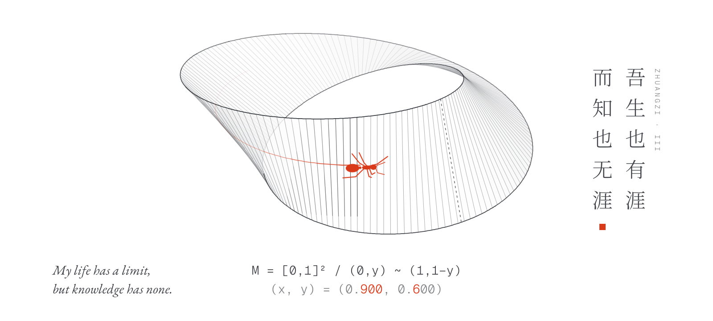

<picture>
  <source media="(prefers-color-scheme: dark)" srcset="./assets/mobius-ant-dark.svg">
  <source media="(prefers-color-scheme: light)" srcset="./assets/mobius-ant-light.svg">
  
</picture>
