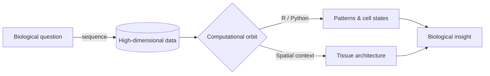

<div align="center">
  
  

  <a href="https://github.com/Reynold4k?tab=followers"></a>
  
  
</div>

<br />

## ◈ 01 // MISSION PROFILE

```text
CALLSIGN   CHEN SATOSHI
ROLE       IMMUNOLOGY PhD CANDIDATE × BIOINFORMATICS RESEARCHER
BASE       THE UNIVERSITY OF MELBOURNE
MISSION    TRANSLATE BIOLOGICAL SIGNALS INTO COMPUTATIONAL CONSTELLATIONS
```

> I study life the way astronomers study the universe: one signal, one pattern,
> one unexplored system at a time.

<table>
  <tr>
    <td width="50%" valign="top">
      <h3>🧬 Research orbit</h3>
      <p>
        Exploring the hidden architecture of immune systems through
        bioinformatics, reproducible computation and data-driven biology.
      </p>
      <ul>
        <li>Computational immunology</li>
        <li>Single-cell &amp; spatial data</li>
        <li>Sequencing analytics</li>
        <li>Reproducible research</li>
      </ul>
    </td>
    <td width="50%" valign="top">
      <h3>🛰️ Flight history</h3>
      <p>
        <b>BSc · Biopharmaceuticals</b><br />
        Nanjing University of Chinese Medicine
      </p>
      <p>
        <b>MPhil · Bioinformatics</b><br />
        The University of Queensland
      </p>
      <p>
        <b>PhD · Immunology · in progress</b><br />
        The University of Melbourne
      </p>
    </td>
  </tr>
</table>



## ◈ 02 // SYSTEMS ONLINE

<div align="center">
  
  <br /><br />
  
  
  
  
</div>

<br />



## ◈ 03 // ACTIVE EXPEDITIONS

<div align="center">
  <a href="https://github.com/Reynold4k/Nanopore_MinimumBIO">
    
  </a>
  <a href="https://github.com/Reynold4k/Stereo_XCR_QC">
    
  </a>
</div>

## ◈ 04 // TELEMETRY

<div align="center">
  
  
</div>

<br />

<div align="center">
  <picture>
    <source media="(prefers-color-scheme: dark)" srcset="https://raw.githubusercontent.com/Reynold4k/Reynold4k/output/github-contribution-grid-snake-dark.svg" />
    <source media="(prefers-color-scheme: light)" srcset="https://raw.githubusercontent.com/Reynold4k/Reynold4k/output/github-contribution-grid-snake.svg" />
    
  </picture>
</div>

## ◈ 05 // BEYOND THE LAB

<div align="center">

| 🎮 RETIRED ENTRY FRAGGER | 🤿 OPEN-WATER DIVER | 🎿 SNOW CHASER | 🚤 VIC PWC & BOAT |
|:---:|:---:|:---:|:---:|
| CSGO → PhD speedrun | Escaped from the dive centre | Seeking winter in a snowless city | Licensed for aquatic side quests |

</div>


<div align="center">
  <sub>TRANSMISSION ENDS · THE SEARCH CONTINUES</sub>
  <br />
  <code>NULLA TENACI INVIA EST VIA</code>
</div>

